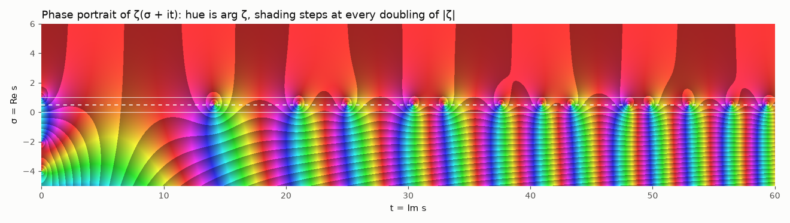
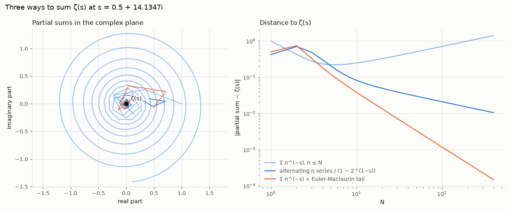
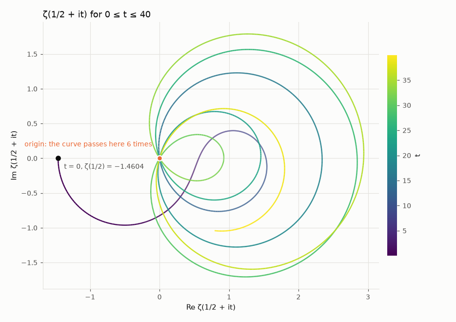
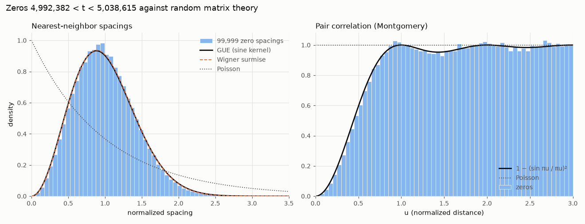
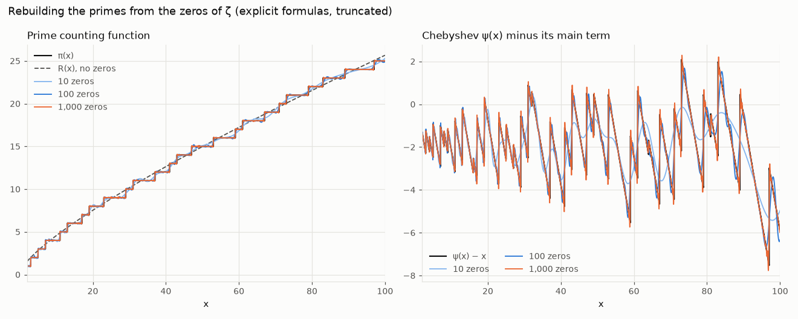
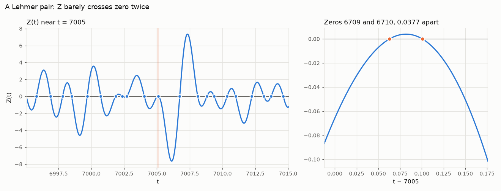
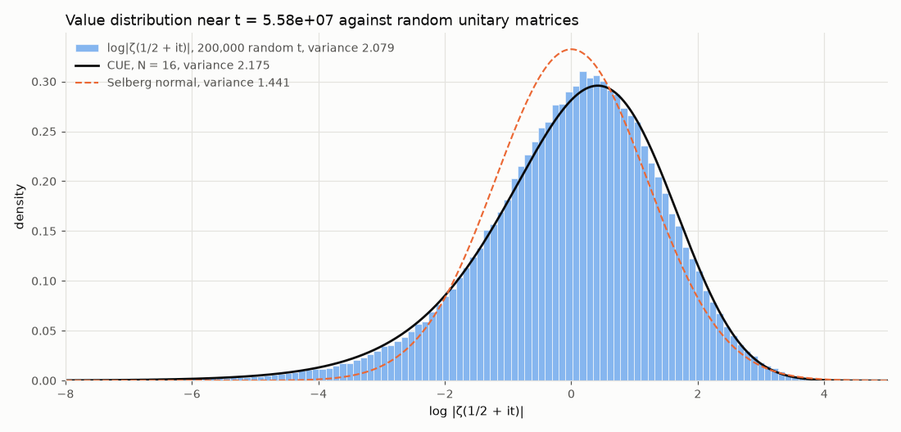

# zeta-explorer

[](https://github.com/louisbelot/zeta-explorer/actions/workflows/tests.yml)



The Riemann Hypothesis says every non-trivial zero of ζ(s) sits on the line
Re(s) = 1/2. On that line ζ is complex, but multiply it by the phase e^(iθ(t)) and
you get the real-valued Riemann-Siegel Z function, which changes sign at every zero.
This repo computes θ, Z, ζ(s) itself, the zeros and the Gram points straight from
the formulas, checks the results against mpmath, and uses Turing's method to prove
the zero count is complete: all 138,069 zeros of ζ with 0 < Im s ≤ 100000 are on
the critical line and simple. It also draws ζ over the complex plane, compares
100,000 zeros near t = 5·10⁶ with the eigenvalue statistics of large random
Hermitian matrices, rebuilds π(x) from the first 1000 zeros, hunts for Lehmer
pairs (the near misses that bound the de Bruijn-Newman constant), and checks the
value distribution of log|ζ(1/2 + it)| against random unitary matrices.

Animations and a browser version come next.

## Install

```bash
pip install "zeta-explorer[plot] @ git+https://github.com/louisbelot/zeta-explorer"
```

## Quick start

```python
from zeta_explorer.riemann_siegel import theta, z_rs, z_exact
from zeta_explorer.zeros import find_zeros, gram_point

find_zeros(10, 30)   # [14.134725141734695, 21.022039638771552, 25.01085758014569]
len(find_zeros(10, 100))   # 29
gram_point(0)        # 17.845599540410863, where theta(t) = 0
z_rs(1000.0)         # 0.9977946375478818 (mpmath: 0.9977946375215866)
z_rs(1000.0, corrections=0)   # 0.9976696568809473, C0 only

from zeta_explorer.zeta import zeta
zeta(-1)             # -1/12
zeta(2 + 3j)         # (0.7980219851462759-0.1137443080529385j)

from zeta_explorer.turing import verify_zeros
verify_zeros(10_000)
# Verification(n=10143, g_n=10000.881777216977, zeros=10144, blocks_after=2)

import numpy as np
zeta(np.array([-3, 0.5 + 14.134725141734693j]))   # vectorized: [1/120, ~1e-16]

from zeta_explorer.spacing import zeros_between, normalized_spacings
z = zeros_between(10**6, 10**6 + 5)   # zeros between Gram points g_1000000 and g_1000005
# [600270.74787059, 600271.48637367, 600271.76148043, 600272.00103217, 600273.02653325]

from zeta_explorer.spacing import first_zeros
from zeta_explorer.explicit import pi_from_zeros, riemann_r
gamma = first_zeros(1000)  # the first 1000 zeros, 14.1347 to 1419.4225
pi_from_zeros(np.array([100.5, 10_000.5]), gamma)   # [25.026, 1229.54]; π = 25, 1229
riemann_r(1e15)      # 29844570495886.9

from zeta_explorer.lehmer import lehmer_pairs
pairs = lehmer_pairs(gamma[:700])   # pairs with Δ²g < 4/5
pairs[0]   # LehmerPair(n=34, gamma=111.0295..., delta=0.8451..., gap=0.3868..., score=0.5699..., bound=-0.3954...)

from zeta_explorer.plot import plot_z, plot_domain, plot_spiral, plot_spacing
plot_z(0, 60).savefig("z.png")
plot_domain().savefig("domain.png")
```

## The math

### Theta

From Stirling's series for log Γ:

```
θ(t) = t/2·log(t/2π) − t/2 − π/8 + 1/(48t) + 7/(5760t³) + …
```

accurate to about 1e-13 for t ≥ 10.

### Riemann-Siegel formula

With a = sqrt(t/2π), N = ⌊a⌋ and p = a − N:

```
Z(t) ≈ 2·Σ_{n=1..N} cos(θ(t) − t·log n)/sqrt(n)  +  (−1)^(N−1)·a^(−1/2)·Σ_{k=0..4} C_k(p)·a^(−k)
```

Only about sqrt(t/2π) terms are needed, so at t = 10⁶ that's 398 terms. The
corrections come from Ψ(p) = cos(2π(p² − p − 1/16)) / cos(2πp) and its
derivatives:

```
C0 = Ψ
C1 = −Ψ⁽³⁾/(96π²)
C2 = Ψ⁽²⁾/(64π²) + Ψ⁽⁶⁾/(18432π⁴)
C3 = −Ψ⁽¹⁾/(64π²) − Ψ⁽⁵⁾/(3840π⁴) − Ψ⁽⁹⁾/(5308416π⁶)
C4 = Ψ/(128π²) + 19Ψ⁽⁴⁾/(24576π⁴) + 11Ψ⁽⁸⁾/(5898240π⁶) + Ψ⁽¹²⁾/(2038431744π⁸)
```

Twelve derivatives of a ratio of cosines is not something to do by hand. Ψ looks
singular at p = 1/4 and 3/4, but the numerator vanishes there too and Ψ is in fact
entire. So the code expands Ψ(1/2 + z) = −cos(2πz² − 5π/8)/cos(2πz) as a Taylor
series in z by dividing the two cosine series. That division runs at 110 digits
in mpmath, because 1/cos has poles at |z| = 1/4 and rounding errors grow like 4^j.
Derivatives of a power series are shifted coefficients, so each C_k becomes a
degree-90 polynomial in z, evaluated with Horner in doubles, and the removable
singularities need no special case. The tests rebuild C1 to C4 from mpmath's
numerical derivatives of Ψ and agree to 1e-15.


Each extra term should buy another factor of t^(−1/2). Over t in [200, 2000], the
largest value of |error|·t^((2k+3)/4) is:

| terms | error order | measured constant |
|---|---|---|
| C0 | t^(−3/4) | 0.119 |
| C0 to C1 | t^(−5/4) | 0.052 |
| C0 to C2 | t^(−7/4) | 0.0090 |
| C0 to C3 | t^(−9/4) | 0.029 |
| C0 to C4 | t^(−11/4) | 0.015 |

The constants come out about the same over [20, 200], which is the real check that
each C_k is right: a wrong coefficient would leave the previous order behind.
The bottom right of the chart is a different story. Past t ≈ 3000 the C3 and C4
curves hit a floor near 3e-11 set by doubles: the phases θ(t) − t·log n are around
10⁵ radians there, so each cosine is only good to about 1e-11. Gabcke (1979)
proved explicit bounds of this form for t ≥ 200, which is why the code trusts
z_rs from t = 200 up and calls mpmath below.

### ζ(s) everywhere

`zeta.py` has no mpmath in the loop. For Re s ≥ 0 it uses Euler-Maclaurin:

```
ζ(s) = Σ_{n<N} n^(−s) + N^(1−s)/(s−1) + N^(−s)/2
       + Σ_{k=1..M} B_2k/(2k)! · s(s+1)…(s+2k−2) · N^(−s−2k+1) + R
```

with Backlund's bound: |R| is at most |s+2M+1|/(σ+2M+1) times the first omitted
term, for σ > −(2M+1). N = 10 + ⌊|t|/π⌋ makes the Bernoulli terms shrink
geometrically, and M grows until the bound drops below 1e-16 relative. The
Bernoulli numbers are exact `Fraction`s. For Re s < 0 it switches to the
functional equation ζ(s) = χ(s)ζ(1 − s), with
χ(s) = 2^s·π^(s−1)·sin(πs/2)·Γ(1 − s) assembled in log space, since at large |t|
the sine overflows and Γ underflows. log Γ is Stirling's series after shifting
|z| past 15, summing the logs of the shifts so the imaginary part stays on the
continuous branch.

Against mpmath on 300 random points with |Re s| ≤ 30 and |Im s| ≤ 200 the
relative error stays under 1e-12. On the critical line at t = 10⁴ the absolute
error is 1.4e-11 (the same phase floor as above). The tests also check
ζ(1 − 2k) = −B_2k/(2k) for k up to 11, that Backlund's bound really bounds the
error and is within 50x of it, that χ(1/2 + it) = e^(−2iθ(t)), and that
e^(iθ)ζ(1/2 + it) is real and equals the Riemann-Siegel Z.

### Phase portrait

The picture at the top is `plot_domain()`: ζ(σ + it) for −5 ≤ σ ≤ 6 and
0 ≤ t ≤ 60, about 600,000 points. Hue is the argument of ζ, and the brightness
ramps up and resets every time |ζ| doubles, so the shading edges are level curves
of |ζ| (Wegert's enhanced phase portrait). A zero is a point where every color
meets, going around once counterclockwise; the pole at s = 1 goes the other way.
All the zeros in the strip sit on the dashed line σ = 1/2, the trivial zeros at
−2 and −4 sit on the left edge, and to the right of σ = 2 the picture is almost
flat red because ζ(s) is close to 1 there.

This needed ζ on arrays. `zeta`, `chi` and `loggamma` now take any array shape:
every point keeps its own N = 10 + ⌊|t|/π⌋, the main sums are one masked
(points × n) matrix built in chunks, and the Euler-Maclaurin tail drops each point
out of the loop as soon as its Backlund bound is small enough. The whole grid
takes 1.05 s, against 6.5 s for a Python loop over the old scalar version.

### Analytic continuation



Σ n^(−s) only converges for σ > 1, and at the first zero s = 1/2 + 14.1347i the
partial sums spiral outward like N^(1/2)/|s − 1|. Two cheap fixes both land on
ζ(s) = 0. The alternating series η(s) = Σ (−1)^(n−1) n^(−s) converges for σ > 0,
and ζ = η/(1 − 2^(1−s)), but its error only falls like N^(−1/2). Adding the
first two Euler-Maclaurin terms N^(1−s)/(s−1) + N^(−s)/2 to the raw partial sum
gives an error of order |s|·N^(−σ−1), N^(−3/2) on the critical line, and it works
anywhere with σ > −1. The tests check both rates.

The functional equation is easiest to see through
ξ(s) = ½s(s − 1)π^(−s/2)Γ(s/2)ζ(s), which cancels the pole and the trivial zeros.
`xi(s)` evaluates it from the right half plane and reflects with ξ(s) = ξ(1 − s);
the tests check it against mpmath, check ξ(0) = ξ(1) = 1/2 and ξ(2) = π/6, and
check that it is real on the critical line.



On the critical line itself, ζ(1/2 + it) traces loops that pass through the
origin once per zero. It starts at ζ(1/2) = −1.4604, and between t = 0 and 40 it
goes through 0 six times.

### Zeros


Sign changes of Z on a grid, refined with the Illinois method
(regula falsi that halves a stuck endpoint's weight). All 29 zeros below t = 100
match mpmath's `zetazero` to 1e-9, and z_rs finds the same 29 to within 4e-6.

### Gram points and Gram's law

These solve θ(g_n) = nπ. θ is increasing and convex there, so Newton's method
started to the right of the root slides monotonically onto it. It's vectorized:
the first 100,001 Gram points take 0.12 s.


At g_n, e^(iθ) = (−1)^n, so if Z behaved like a cosine with one zero per Gram
interval we would always have (−1)^n Z(g_n) > 0. That's Gram's law. It first
fails at g_126 (Hutchinson, 1925). Up to n = 1000, 95.8% of Gram points are good;
up to 10,000, 91.8%; up to 100,000 (t ≈ 74,922), 88.9%.

A Gram block is a run [g_j, g_k) between consecutive good points. Rosser's rule
says a block of length k − j contains at least k − j zeros. The checker samples Z
inside each block, doubling the density until it sees enough sign changes. Up to
n = 100,000 every block passes:

| block length | 1 | 2 | 3 | 4 | 5 |
|---|---|---|---|---|---|
| count | 78,694 | 9,445 | 778 | 19 | 1 |

Rosser's rule does fail eventually; Brent found the first failure near
g_13999525. The signs come from z_rs with all four corrections. Any |Z| below 1e-6
is recomputed with mpmath before it's trusted, and below t = 200 mpmath is used
throughout.

### Turing's method

Sign changes of Z give a lower bound on N(T), the number of zeros with
0 < Im s ≤ T. A zero off the critical line, or a double zero, wouldn't show up as
a sign change. The upper bound comes from S(t) = N(t) − θ(t)/π − 1: Lehman proved
|∫ S(t) dt| ≤ 1.7 + 0.114·log t₂ over any [t₁, t₂] above 168, so S can't stay
positive for long. Brent turned that into a block count. If K consecutive Gram
blocks [g_n, g_p) obey Rosser's rule and

```
K ≥ (0.114/6π)·log² g_p + ((1.7 − 0.114·log 2π)/6π)·log g_p   (≈ 0.0061 log² + 0.08 log)
```

then N(g_n) ≤ n + 1. `verify_zeros(T)` finds a good Gram point g_n ≥ T, counts
n + 1 sign changes of Z below it, and finds the K blocks past it. The two bounds
meet, so every zero up to g_n is a sign change, which means it is on the line and
simple. For T = 100,000 it runs in 9 seconds, needs K = 2 blocks, and stops at
g_138068 ≈ 100000.29 with N = 138,069 (mpmath's `nzeros` agrees). The tests
cross-check smaller heights the same way.

### Zero spacings and random matrices



Montgomery conjectured in 1973 that the pair correlation of the zeros, measured in
units of the mean spacing, is 1 − (sin πu/πu)². Dyson recognized it as the pair
correlation of eigenvalues of large random Hermitian matrices (GUE), and Odlyzko's
computations from 1987 on confirmed it numerically.

`zeros_between(n_lo, n_hi)` finds every zero between two good Gram points. It
evaluates Z at the Gram points, samples each Gram block more finely until it has as
many sign changes as the block has intervals, then refines every bracket at once
with a vectorized Illinois method on z_rs. Between n = 10⁷ and 10⁷ + 100,000 it
finds exactly 100,000 zeros in 18 s. That count matters for the statistics: a
missed pair of close zeros would hide exactly the small spacings the plot is
about. The zeros are unfolded with x = θ(γ)/π, which makes the mean spacing 1.

The GUE curve is the exact sine-kernel answer, not the Wigner surmise. The
probability of no eigenvalue in an interval of length s is the Fredholm
determinant E(s) = det(I − K) with K(x, y) = sin π(x − y)/(π(x − y)) on [0, s].
Following Bornemann (2010), Gauss-Legendre quadrature with 40 nodes turns it into
an ordinary 40×40 determinant, and the error falls exponentially with the node
count (20 and 60 nodes agree to 1e-12). The spacing density is p(s) = E''(s); E
is entire, so the code interpolates it with a degree-80 Chebyshev series on
[0, 6] and differentiates the series twice. Checks: p(s) matches
π²s²/3 − 2π⁴s⁴/45 + π⁶s⁶/315 for small s, the derivatives agree with 30-digit
mpmath to 3e-10, p integrates to 1 with mean 1, and the variance comes out
0.17999 (the Wigner surmise gives 3π/8 − 1 = 0.1781). An independent check
samples 300 random 120×120 GUE matrices: the KS distance between their bulk
spacings and the sine-kernel CDF is 0.0044, against 0.28 for Poisson.

The zeros fit GUE well, but not perfectly, and the gap shrinks with height. For
100,000 consecutive zeros starting at three heights:

| first zero | t range | spacing variance | KS distance to GUE | R₂ − Montgomery, 0.3 < u < 0.9 |
|---|---|---|---|---|
| n = 10⁵ | 74,924 to 139,503 | 0.1636 | 0.0174 | −0.012 |
| n = 10⁶ | 600,271 to 654,852 | 0.1668 | 0.0138 | −0.013 |
| n = 10⁷ | 4,992,382 to 5,038,615 | 0.1693 | 0.0110 | −0.013 |
| GUE | | 0.1800 | 0 | 0 |

The zeros are more regular than GUE at these heights: smaller variance, a taller
peak in the histogram, and slightly fewer close pairs. The variance and the KS
distance move toward GUE as t grows; the dip in the pair correlation barely moves
over this range. This is the finite-height
effect Bogomolny, Keating and coauthors explained by matching the zeros at height
t to unitary matrices of effective size log(t/2π)/√(12Λ), where Λ ≈ 1.573, which is
only about 3 at t = 5·10⁶. It decays like 1/log² t, so it is still visible in
Odlyzko's data near zero number 10²³.

### The explicit formula



Riemann's 1859 formula writes the prime counting function as a smooth main term
minus a sum over the zeros. The cleanest version is for Chebyshev's
ψ(x) = Σ_{p^k ≤ x} log p:

```
ψ(x) = x − Σ_ρ x^ρ/ρ − log 2π − ½·log(1 − x⁻²)
```

For π(x) it goes through J(x) = Σ_k π(x^(1/k))/k, which jumps by 1/k at every
prime power p^k:

```
J(x) = li(x) − Σ_ρ li(x^ρ) − log 2 + ∫_x^∞ dt / (t(t² − 1) log t)
π(x) = Σ_n μ(n)/n · J(x^(1/n))
```

The sum over n stops once x^(1/n) < 2, since J is 0 there. Both sums over ρ pair
each zero with its conjugate and run in order of height. At a jump both formulas
converge to the midpoint, so the code gives ψ(97) − ½·log 97 for ψ(97) and 24.5
for π(97).

The awkward part is li(x^ρ). Taking li of the complex number x^ρ lands on the
wrong branch as soon as γ·log x passes π, so it has to be Ei(ρ·log x). `ei(w)` is
written from scratch with three regimes: the power series for |w| < 4, the
continued fraction for E₁ (backward recurrence, depth 20 to 140 depending on |w|)
out to |w| = 40, and the asymptotic series beyond that. It matches mpmath to
1.5e-15 relative on 2,851 random points. The one region it refuses is
4 ≤ |w| < 40 within π/4 of the positive real axis, where neither the continued
fraction nor the series is accurate in doubles. The explicit formula never goes
there, because ρ·log x sits next to the imaginary axis. li(x) for real x, Riemann's
R(x) from the Gram series Σ (log x)^k/(k·k!·ζ(k+1)), and the tail integral
(40-node Gauss-Laguerre after substituting t = e^v) are all checked against
mpmath.

With the first 1000 zeros, on the half-integers 2.5 ≤ x ≤ 100.5:

| zeros | max error ψ | RMS error ψ | max error π | RMS error π |
|---|---|---|---|---|
| 100 | 0.96 | 0.28 | 0.21 | 0.069 |
| 1000 | 0.148 | 0.050 | 0.033 | 0.012 |

π(x) from 1000 zeros also rounds to the right integer at every half-integer from
1000.5 to 1099.5 (worst error 0.35), and π(10000.5) comes out as 1229.54 against
the true 1229. The left panel, 3000 values of x and 1000 zeros, takes 3.3 s. The
zeros come from `first_zeros(n)`, which sign-scans mpmath's Z below the good Gram
point g₇₉ ≈ 201.5 and uses `zeros_between` above it.

### Lehmer pairs



In 1956 Lehmer found two zeros near t = 7005 only 0.0377 apart, with Z rising to
just 0.004 between them. Close pairs like this used to give lower bounds on the
de Bruijn-Newman constant Λ (Rodgers and Tao proved Λ ≥ 0 in 2018). In the
convention of Csordas, Smith and Varga the zeros are x = 2γ, the zeros of
H₀(x) = Ξ(x/2)/8. A pair x_k < x_(k+1) with Δ = x_(k+1) − x_k and

```
g = Σ_{j ≠ k, k+1} [ 1/(x_j − x_k)² + 1/(x_j − x_(k+1))² ]     (j over positive and negative zeros)
```

is a Lehmer pair if Δ²g < 4/5, and then

```
Λ ≥ λ = [ (1 − 5Δ²g/4)^(4/5) − 1 ] / (8g)
```

Δ²g doesn't depend on the scale, so the code works with γ directly and divides
by 2g instead of 8g. `lehmer_sums` adds the 500 nearest zeros on each side
exactly, the mirrored negative zeros exactly over the first 500, and everything
further out through the smooth density log(t/2π)/2π, integrated in closed form.
That density integrates to the main term of θ(t)/π + 1 when it starts from
T₀ = 9.6769, where the smooth count is zero.

The real check doesn't use any list of zeros. Ξ(t) is even with real zeros ±γ,
so −(log Ξ)''(t) = Σ_j [1/(t − γ_j)² + 1/(t + γ_j)²]. Removing the two singular
terms leaves g in terms of Z', Z'' and Z''' at the two zeros plus a trigamma term
from the Gamma factor, all of which mpmath computes directly. The two agree to
3e-6 relative, both on the first pair and on Lehmer's.

Results:

- Below t = 1000 there are exactly 29 Lehmer pairs among the 649 zeros, the count
  Stopple reports in "Lehmer pairs revisited" (2017).
- Lehmer's pair (zeros 6709 and 6710): Δ = 0.0376985 in γ, Δ²g = 0.006933 and
  λ = −7.112e-4. The maximum of Z between them is 0.00397 at t = 7005.0818554,
  next to the zero of ζ' that Stopple lists at 7005.08185555.
- Up to t = 10⁵, 8,262 of the 138,068 consecutive pairs (6.0%) are Lehmer pairs.
  The tightest is zeros 95,248 and 95,249 near t = 71,732.90: 0.0147 apart (0.022
  mean spacings), with Δ²g = 0.0020 and λ = −1.08e-4.
- Starting at t ≈ 10⁶, 7,384 of 114,660 consecutive pairs qualify. Stopple counts
  7,398 of 114,661 near the same height, presumably over a slightly different
  window.
- Csordas, Odlyzko, Smith and Varga (1993) give Δ = 2.171392e-4 in x units for the
  pair van de Lune, te Riele and Winter found near t = 3.9·10⁸. `newman_bound`
  turns that into −5.894e-9; their published bound is −5.895e-9. That pair is out
  of reach here: Z peaks at about 1e-8 between the two zeros, below the rounding
  floor of z_rs at that height.

### Large values and the value distribution

`z_extrema(gamma)` finds the extremum of Z between each pair of consecutive zeros
with a vectorized golden-section search (Z is unimodal between consecutive zeros
in practice). Over all 138,068 gaps below t = 10⁵ (26 s), the running record of
|Z| ends with

| t | Z(t) |
|---|---|
| 50,626.478 | 23.747 |
| 55,104.583 | −24.830 |
| 63,751.863 | −26.073 |
| 74,956.025 | −27.694 |
| 77,403.722 | 28.216 |

and each of those values matches mpmath's `siegelz` to 1e-10.



Selberg's central limit theorem says log|ζ(1/2 + it)| divided by
sqrt(½·log log T) tends to a standard normal. Keating and Snaith (2000) proposed a
much sharper model: the characteristic polynomial of a random N×N unitary matrix
(CUE) with N = log(T/2π). Its moment generating function is exact,

```
E|det(I − U)|^s = Π_{j=1..N} Γ(j)·Γ(j + s) / Γ(j + s/2)²
```

so the cumulants are κ_m = (1 − 2^(1−m))·Σ_{j≤N} ψ^(m−1)(j), and the density
comes from Fourier inversion of the product along s = iu (trapezoid rule, step
0.01). The density integrates to 1 within 1e-9, its moments match the cumulants,
and a histogram of 20,000 Haar-random 12×12 unitaries sits within 0.015 of it.

Sampling 200,000 random t in [T, 1.01·T] with T = 2π·e^N, so that N is an
integer:

| N | T | variance | κ₃ | CUE variance | CUE κ₃ | Selberg ½ log log T |
|---|---|---|---|---|---|---|
| 8 | 1.87·10⁴ | 1.730 | −2.10 | 1.829 | −2.374 | 1.143 |
| 10 | 1.38·10⁵ | 1.864 | −2.20 | 1.940 | −2.393 | 1.236 |
| 12 | 1.02·10⁶ | 1.957 | −2.14 | 2.031 | −2.405 | 1.314 |
| 14 | 7.56·10⁶ | 2.019 | −2.13 | 2.108 | −2.414 | 1.381 |
| 16 | 5.58·10⁷ | 2.093 | −2.10 | 2.175 | −2.421 | 1.441 |

The means are all within 0.011 of zero. Selberg's normal is far too narrow at
these heights: the variance does grow like ½ log log T, but with 0.59 to 0.65 on
top. CUE gets the variance within 0.1, and it gets the strong negative skew right
in sign and roughly in size (log|ζ| has a long left tail from the zeros). The
remaining gap in the variance, 0.074 to 0.099, doesn't shrink with N. It looks
like the arithmetic correction from small primes that the hybrid model of Gonek,
Hughes and Keating puts on top of CUE, but I haven't computed that constant. The
fourth cumulant (5.5 to 6.7, against 6.3 for CUE) is too noisy at this sample
size to say more.

## Development

```bash
pip install -e ".[dev]"
pytest
ruff check .
```

## License

MIT
