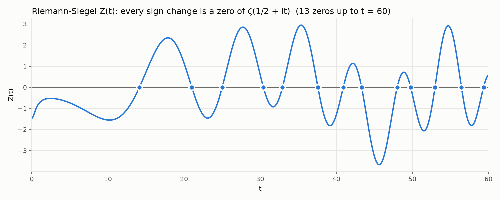
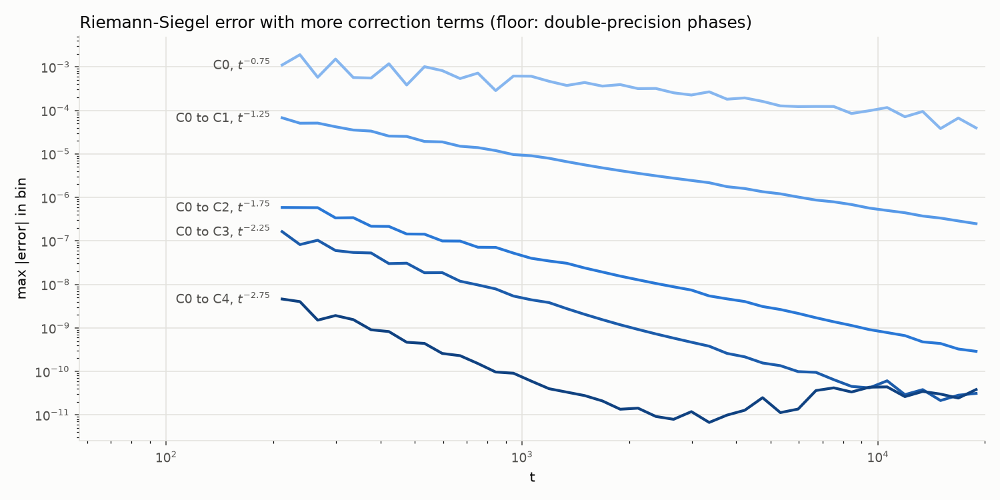
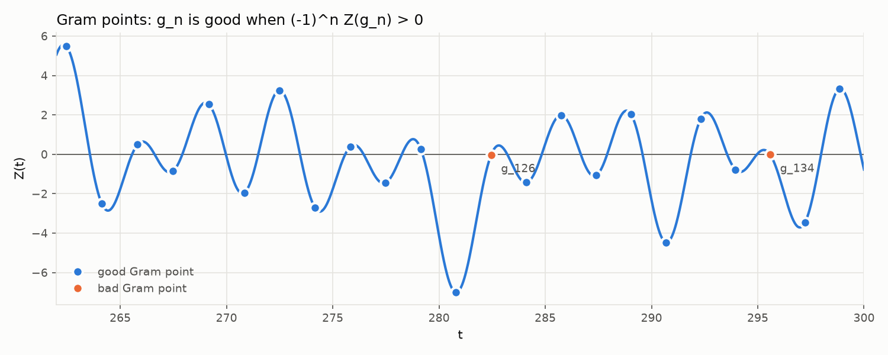

# zeta-explorer

[](https://github.com/louisbelot/zeta-explorer/actions/workflows/tests.yml)



The Riemann Hypothesis says every non-trivial zero of ζ(s) sits on the line
Re(s) = 1/2. On that line ζ is complex, but multiply it by the phase e^(iθ(t)) and
you get the real-valued Riemann-Siegel Z function, which changes sign at every zero.
This repo computes θ, Z, ζ(s) itself, the zeros and the Gram points straight from
the formulas, checks the results against mpmath, and uses Turing's method to prove
the zero count is complete: all 138,069 zeros of ζ with 0 < Im s ≤ 100000 are on
the critical line and simple.

Domain coloring of the critical strip, statistics of the zero spacings, animations
and a browser version come next.

## Install

```bash
pip install "zeta-explorer[plot] @ git+https://github.com/louisbelot/zeta-explorer"
```

## Quick start

```python
from zeta_explorer.riemann_siegel import theta, z_rs, z_exact
from zeta_explorer.zeros import find_zeros, gram_point

find_zeros(10, 30)   # [14.134725141734695, 21.022039638771552, 25.01085758014569]
len(find_zeros(10, 100))   # 29
gram_point(0)        # 17.845599540410863, where theta(t) = 0
z_rs(1000.0)         # 0.9977946375478818 (mpmath: 0.9977946375215866)
z_rs(1000.0, corrections=0)   # 0.9976696568809473, C0 only

from zeta_explorer.zeta import zeta
zeta(-1)             # -1/12
zeta(2 + 3j)         # (0.7980219851462759-0.1137443080529385j)

from zeta_explorer.turing import verify_zeros
verify_zeros(10_000)
# Verification(n=10143, g_n=10000.881777216977, zeros=10144, blocks_after=2)

from zeta_explorer.plot import plot_z, plot_gram, plot_rs_error
plot_z(0, 60).savefig("z.png")
```

## The math

### Theta

From Stirling's series for log Γ:

```
θ(t) = t/2·log(t/2π) − t/2 − π/8 + 1/(48t) + 7/(5760t³) + …
```

accurate to about 1e-13 for t ≥ 10.

### Riemann-Siegel formula

With a = sqrt(t/2π), N = ⌊a⌋ and p = a − N:

```
Z(t) ≈ 2·Σ_{n=1..N} cos(θ(t) − t·log n)/sqrt(n)  +  (−1)^(N−1)·a^(−1/2)·Σ_{k=0..4} C_k(p)·a^(−k)
```

Only about sqrt(t/2π) terms are needed, so at t = 10⁶ that's 398 terms. The
corrections come from Ψ(p) = cos(2π(p² − p − 1/16)) / cos(2πp) and its
derivatives:

```
C0 = Ψ
C1 = −Ψ⁽³⁾/(96π²)
C2 = Ψ⁽²⁾/(64π²) + Ψ⁽⁶⁾/(18432π⁴)
C3 = −Ψ⁽¹⁾/(64π²) − Ψ⁽⁵⁾/(3840π⁴) − Ψ⁽⁹⁾/(5308416π⁶)
C4 = Ψ/(128π²) + 19Ψ⁽⁴⁾/(24576π⁴) + 11Ψ⁽⁸⁾/(5898240π⁶) + Ψ⁽¹²⁾/(2038431744π⁸)
```

Twelve derivatives of a ratio of cosines is not something to do by hand. Ψ looks
singular at p = 1/4 and 3/4, but the numerator vanishes there too and Ψ is in fact
entire. So the code expands Ψ(1/2 + z) = −cos(2πz² − 5π/8)/cos(2πz) as a Taylor
series in z by dividing the two cosine series. That division runs at 110 digits
in mpmath, because 1/cos has poles at |z| = 1/4 and rounding errors grow like 4^j.
Derivatives of a power series are shifted coefficients, so each C_k becomes a
degree-90 polynomial in z, evaluated with Horner in doubles, and the removable
singularities need no special case. The tests rebuild C1 to C4 from mpmath's
numerical derivatives of Ψ and agree to 1e-15.



Each extra term should buy another factor of t^(−1/2). Over t in [200, 2000], the
largest value of |error|·t^((2k+3)/4) is:

| terms | error order | measured constant |
|---|---|---|
| C0 | t^(−3/4) | 0.119 |
| C0 to C1 | t^(−5/4) | 0.052 |
| C0 to C2 | t^(−7/4) | 0.0090 |
| C0 to C3 | t^(−9/4) | 0.029 |
| C0 to C4 | t^(−11/4) | 0.015 |

The constants come out about the same over [20, 200], which is the real check that
each C_k is right: a wrong coefficient would leave the previous order behind.
The bottom right of the chart is a different story. Past t ≈ 3000 the C3 and C4
curves hit a floor near 3e-11 set by doubles: the phases θ(t) − t·log n are around
10⁵ radians there, so each cosine is only good to about 1e-11. Gabcke (1979)
proved explicit bounds of this form for t ≥ 200, which is why the code trusts
z_rs from t = 200 up and calls mpmath below.

### ζ(s) everywhere

`zeta.py` has no mpmath in the loop. For Re s ≥ 0 it uses Euler-Maclaurin:

```
ζ(s) = Σ_{n<N} n^(−s) + N^(1−s)/(s−1) + N^(−s)/2
       + Σ_{k=1..M} B_2k/(2k)! · s(s+1)…(s+2k−2) · N^(−s−2k+1) + R
```

with Backlund's bound: |R| is at most |s+2M+1|/(σ+2M+1) times the first omitted
term, for σ > −(2M+1). N = 10 + ⌊|t|/π⌋ makes the Bernoulli terms shrink
geometrically, and M grows until the bound drops below 1e-16 relative. The
Bernoulli numbers are exact `Fraction`s. For Re s < 0 it switches to the
functional equation ζ(s) = χ(s)ζ(1 − s), with
χ(s) = 2^s·π^(s−1)·sin(πs/2)·Γ(1 − s) assembled in log space, since at large |t|
the sine overflows and Γ underflows. log Γ is Stirling's series after shifting
|z| past 15, summing the logs of the shifts so the imaginary part stays on the
continuous branch.

Against mpmath on 300 random points with |Re s| ≤ 30 and |Im s| ≤ 200 the
relative error stays under 1e-12. On the critical line at t = 10⁴ the absolute
error is 1.4e-11 (the same phase floor as above). The tests also check
ζ(1 − 2k) = −B_2k/(2k) for k up to 11, that Backlund's bound really bounds the
error and is within 50x of it, that χ(1/2 + it) = e^(−2iθ(t)), and that
e^(iθ)ζ(1/2 + it) is real and equals the Riemann-Siegel Z.

### Zeros

Sign changes of Z on a grid, refined with the Illinois method
(regula falsi that halves a stuck endpoint's weight). All 29 zeros below t = 100
match mpmath's `zetazero` to 1e-9, and z_rs finds the same 29 to within 4e-6.

### Gram points and Gram's law

These solve θ(g_n) = nπ. θ is increasing and convex there, so Newton's method
started to the right of the root slides monotonically onto it. It's vectorized:
the first 100,001 Gram points take 0.12 s.



At g_n, e^(iθ) = (−1)^n, so if Z behaved like a cosine with one zero per Gram
interval we would always have (−1)^n Z(g_n) > 0. That's Gram's law. It first
fails at g_126 (Hutchinson, 1925). Up to n = 1000, 95.8% of Gram points are good;
up to 10,000, 91.8%; up to 100,000 (t ≈ 74,922), 88.9%.

A Gram block is a run [g_j, g_k) between consecutive good points. Rosser's rule
says a block of length k − j contains at least k − j zeros. The checker samples Z
inside each block, doubling the density until it sees enough sign changes. Up to
n = 100,000 every block passes:

| block length | 1 | 2 | 3 | 4 | 5 |
|---|---|---|---|---|---|
| count | 78,694 | 9,445 | 778 | 19 | 1 |

Rosser's rule does fail eventually; Brent found the first failure near
g_13999525. The signs come from z_rs with all four corrections. Any |Z| below 1e-6
is recomputed with mpmath before it's trusted, and below t = 200 mpmath is used
throughout.

### Turing's method

Sign changes of Z give a lower bound on N(T), the number of zeros with
0 < Im s ≤ T. A zero off the critical line, or a double zero, wouldn't show up as
a sign change. The upper bound comes from S(t) = N(t) − θ(t)/π − 1: Lehman proved
|∫ S(t) dt| ≤ 1.7 + 0.114·log t₂ over any [t₁, t₂] above 168, so S can't stay
positive for long. Brent turned that into a block count. If K consecutive Gram
blocks [g_n, g_p) obey Rosser's rule and

```
K ≥ (0.114/6π)·log² g_p + ((1.7 − 0.114·log 2π)/6π)·log g_p   (≈ 0.0061 log² + 0.08 log)
```

then N(g_n) ≤ n + 1. `verify_zeros(T)` finds a good Gram point g_n ≥ T, counts
n + 1 sign changes of Z below it, and finds the K blocks past it. The two bounds
meet, so every zero up to g_n is a sign change, which means it is on the line and
simple. For T = 100,000 it runs in 9 seconds, needs K = 2 blocks, and stops at
g_138068 ≈ 100000.29 with N = 138,069 (mpmath's `nzeros` agrees). The tests
cross-check smaller heights the same way.

## Development

```bash
pip install -e ".[dev]"
pytest
ruff check .
```

## License

MIT
